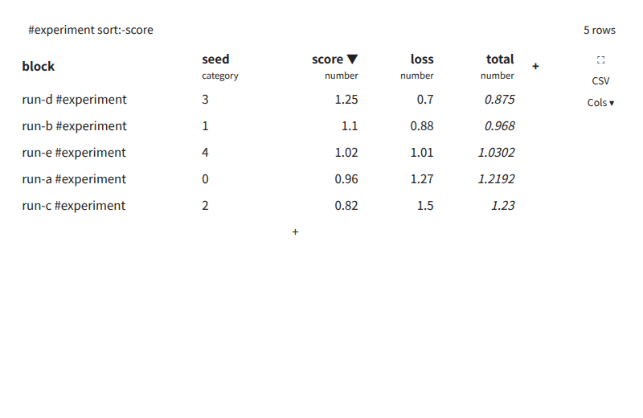

# Data Query for Logseq

> **Beta.** Works with Logseq 0.10.x (Markdown/file graphs). Feedback and bug reports are welcome in [Issues](https://github.com/gyp0bt/logseq-dataquery/issues).

**English** · [日本語](#日本語) · [中文](#中文)

Turn blocks with properties into a typed table, scatter plot or bar chart — right where you write them. Tables work like a small spreadsheet: arrow keys, formulas, drag-select, copy and paste, full screen.



```
- Seed sweep
  - {{renderer :DQscatter, #experiment x:score y:loss color:seed}}
  - run-a #experiment
    seed:: 0
    score:: 0.96
    loss:: 1.27/1.31/1.29
  - run-b #experiment
    seed:: 1
    score:: 1.10
    loss:: 0.88
```

Three macros, inserted with `/DQ table`, `/DQ scatter` and `/DQ bar`:

| Macro | Shows | Buttons on the right |
|---|---|---|
| `{{renderer :DQtable, …}}` | table | CSV |
| `{{renderer :DQscatter, …}}` | scatter plot + folded table | X▾ Y▾ Color▾ ± ▤ ⟲ ⤢ CSV |
| `{{renderer :DQbar, …}}` | bar chart (means, min–max whiskers) + folded table | X▾ Y chips + Y▾ ⤢ CSV |

Keep the comma after the macro name, as with any Logseq renderer.

## Why

Logseq's built-in query tables compare property values as text, so `10 < 9`, `0.20 ≠ 0.2`, and there are no charts. Data Query reads the raw property text, infers a type per key, and compares numbers as numbers. Values are always shown exactly as you wrote them.

## Which blocks become rows

Every block in the graph that has at least one property of its own. Blocks with only Logseq's built-in properties (`id`, `collapsed`, `heading`, …) and page-property blocks are skipped.

## Query

Terms are separated by spaces and all must hold. An empty query shows every property block in the graph.

| Term | Meaning | Example |
|---|---|---|
| `#tag` `#[[a b]]` `[[page]]` | Blocks that reference the page (tags on ancestors count) | `#experiment` |
| `key op value` | Filter. `op` is `== != < <= > >=` (`=` means `==`) | `seed==0` `gre-interp<0` |
| `name:value` | Setting (below) | `x:gre-thin` `sort:-r2` |
| `key` | Blocks that have the property | `gre-thin` |

- Numeric columns compare as numbers. `key==a,b` means a or b. On a number-list column such as `8/16`, `==16` means "contains 16". `<`, `>` and friends compare the mean of a multi-valued cell.
- Quote values with spaces or commas: `note=="8 cells, seed"`.

| Setting | Meaning | Default |
|---|---|---|
| `x:` `y:` | Axes. A bar chart takes several: `y:a,b` | Scatter: 1st and 2nd numeric column. Bar: x = 1st category/text column, y = 1st numeric column |
| `color:` | Scatter colour groups (one legend entry per group; it wins over `by:`, below). A bar chart splits each category into one bar per value | scatter: the `by:` value if set, else one colour; bar: one colour per y column |
| `sort:key` / `sort:-key` | Ascending / descending; clicking a table header cycles it | outline order |
| `by:run` | Blocks with the same `run` become one row; the newest journal wins and disagreeing cells get ⚠ | no merge |
| `labels:on` | Write every point's name on the chart | names on hover |
| `err:bar` / `err:band` | Scatter: pool each group into a mean with min–max bars / band (below); `err:off` is the same as leaving it out | every row is its own point |
| `hide:a,b` | Columns left out of the table and CSV (still offered by the axis and colour pickers) | all shown |
| `img:96` | Size in px of every image in the table (24–400): each picture is scaled so that the harmonic mean of its width and height, 2wh/(w+h), equals it, so wide, tall and square pictures look equally big | 64 |

Edit the query right in the view: change the line at the top and press Enter to write it back into the macro (Esc cancels; keys typed there never reach Logseq, so Esc does not open the raw block text). Mistakes are shown under the line with a caret, and nothing is saved until the query is valid. Click blank space in the view to edit the block's raw text, as with Logseq's own renderers. While the query line has focus, repaints wait until you leave it, so a half-typed query is never wiped.

## Several values in one cell

A property such as `loss:: 1.27/1.31/1.29` (or `1.27, 1.31`) holds several numbers, e.g. one per seed. A scatter draws every row as its own point at its mean (coloured by group) until **±** or **▤** is on; then each group is pooled into a mean with the min–max of **y only**. An x cell with several numbers just sits at their mean.

- **Groups (scatter):** the group key is `color:` if set, else `by:`; the blocks sharing its value form a group (the table still merges `by:` rows into one row). With neither, each row is its own group. Within a group, every y number at the same x is pooled.
- **One x in a group:** one marker at the mean of y, with a vertical min–max bar (none for a single value).
- **Several x in a group:** a line through the per-x means in x order, a marker and a min–max bar at each x.
- **No `err:` (default):** no pooling, one point per row. **`err:bar` (±):** the pooled means and bars above. **`err:band` (▤):** a translucent min–max band (like plotly's `fill='tonexty'`) instead of bars along groups with several x; a single-x group keeps its bar.
- Each group is coloured by its own value; rows without one form the `(none)` group.
- **Bar:** with `color:` each category gets one bar per y column × colour value (legend `key = value`, or `y · value` with several y). Each row counts at its mean; whiskers span the rows of a category. With `x:` set to the `by:` key, each category is one `by` value and its whisker spans that value's blocks.
- Hover shows the group (the `color:` value, else the `by:` value, else the block name), x, and y mean, min, max and n. The table shows the text as written and sorts by the mean.

## Buttons and pointer

- **X▾ Y▾ Color▾** pick a column (a bar chart's X takes any column; the `by:` key is offered too, also for Color, whose blank entry reads `by: run` while `by:` drives the colours). A bar chart shows its y columns as chips: **×** removes one (removing the last drops `y:`, back to the default) and **+ Y▾** appends a numeric column not shown yet. A bar chart's **Color▾** splits the bars by a column. **±** (pooled error bars) and **▤** (pooled band) are on/off toggles; the lit one is active, pressing it again goes back to one point per row. These and table-header clicks rewrite the macro, so the view is saved with the page; any other text you wrote in the query stays as it was.
- **⟲** resets zoom and shows hidden traces; **⤢** enlarges the chart. Both are temporary and do not touch the macro.
- **CSV** copies the rows and columns on screen to the clipboard.
- **Cols▾** lists every column (the `by:` key too) with a checkbox; unticking one writes it into `hide:`.
- **Images in cells:** `` (one or several) and cells holding just an image path or URL (png, jpg, jpeg, gif, webp, svg) show as thumbnails. `../assets/x.png` loads from the graph folder; only http, https and file URLs load. Click one to see it large; click or Esc closes. **Img − +** (shown when the table has images) and **Ctrl + wheel** over an image resize every image in the table and save the size as `img:`.
- **Edit cells:** double-click a cell, type, Enter saves the property to its block (empty removes it), Esc cancels. In a `by:` row only a key that one block holds can be edited. The **+** header cell adds a column: type a new lower-case property name; it stays until you write a value into it.
- Charts: hover for values (the title is the group's value), drag to zoom, double-click blank plot area to reset, click a point to open the table and highlight the rows of its group.
- Under a scatter or bar chart the table is folded behind a one-line **▸ Table (N rows)** toggle; it stays as you left it while the view redraws. CSV works while folded.
- Axis handles (scatter): drag the left or right quarter of the x axis to move only that end, the middle to pan; the same for the y axis (bottom end, top end, middle). **Double-click an end** to type its value (Enter applies, Esc or clicking away cancels); double-click the middle to reset that axis only.
- **Ctrl + wheel** over a chart scales markers, lines and axis text (0.5×–3×); the legend keeps its size. A plain wheel scrolls the page.
- **Double-click** a legend entry, or a marker, line, band or bar of a trace, to hide that trace; its legend entry stays greyed so you can double-click it back.
- Bar charts with many categories keep each category at least 56 px wide (24 px more per extra y column) and scroll sideways. Long category labels wrap to the category width (up to three lines, then `…`; hover the label for the full text).
- Zoom, scale and hidden traces are temporary but survive the view being redrawn.
- Tables: hold the middle button and drag to scroll sideways (the table moves against the pointer, like a scrollbar thumb). The middle click does not paste on Linux.

The old `{{renderer :dataquery, …}}` macro is no longer drawn; replace it with one of the three above.

## Table as a spreadsheet

Click a cell and the table takes the keyboard (Logseq does not see those keys until you press Esc).

| Key / action | Does |
|---|---|
| Arrows, Tab, Enter | Move between cells. Shift extends the selection, Ctrl jumps to the edge |
| Just type | Starts editing the cell; Enter saves and moves down, Tab saves and moves right, Esc cancels. F2 or double-click edits with the old value |
| Delete / Backspace | Clears the selected cells (removes the properties) |
| Drag, Shift+arrows, Ctrl+A | Select a range |
| Ctrl+C / X / V | Copy / cut / paste. Copies tab-separated text **and** an HTML table, so Excel and Google Sheets paste it as cells (a browser clipboard cannot carry an .xlsx file). Pasting a block of cells writes each into its block |
| Ctrl+V with a picture | Puts the picture into the cell. Logseq gives plugins no way to write into `assets/`, so it is stored in the cell as a `data:` URL (scaled to ≤ 1024 px) |
| Enter on the last row (not the Enter that saves a cell), or the **+** row | Adds a row: a new block below the last row's block, carrying a header line (`row 3`), `tags::` and any `key==value` of the query |
| Click a row's label / double-click it | Go to its block (a full-screen view is left first) / rename it (writes the first line of the block, or of the parent block that supplies the label; not with `by:`). Also in the right-click menu |
| Right-click a row | Menu with **Delete row** (removes the row's block; Logseq's undo brings it back) |
| `f` or ⛶ | Toggle full screen (Esc does not leave it). So typing starts a cell with any key except a lower-case `f`: use F2, double-click or Shift+F for text starting with it |

**Formulas.** A cell starting with `=` is a formula, stored as the property text (`total:: =score*loss`). It reads other cells **of the same row** by column name, with `+ - * / % ^`, `&` (join text), comparisons and JS-style functions: `abs round floor ceil sqrt pow mod exp log log10 sin cos atan2 hypot min max sum avg median stdev count if and or not concat len upper lower`, plus `pi` and `e` Ranges such as `a:c` work inside functions. While typing a formula, **arrow keys or a click pick a cell** into it, as in Excel. A bad formula shows `#ERR` with the reason on hover.

**Units.** Logseq refuses `[]` and spaces in property names, so the unit follows a double hyphen: `power--w:: 5` has unit `W`. The header shows `power` with `W · number` under it (common units get their capitals back: `w` → `W`, `mpa` → `MPa`); a key without `--` has unit `-` (dimensionless). Use the full key in queries: `x:power--w`.

**Labels without `by:`.** A block with no text of its own is named after its parent block: `## CheckItem1` with a child `id:: abc` shows as `CheckItem1`.

## Types

Inferred per key across the whole graph:

- `number` — every value is a number
- `numlist` — numbers joined by `/` or `,`, e.g. `8/16`
- `string` — anything else

Override them on the types page (default `dataquery/types`, configurable in the plugin settings), as page properties at the top of the page. `*` matches any text; an exact key beats a pattern, and a longer pattern beats a shorter one.

```
seed:: category
score-*:: ratio
```

- `category` — discrete values (good for `color:` and bar `x:`), even when they look like numbers
- `ratio` — a value divided by its threshold. Charts draw a dashed line at 1.00, a scatter with both axes `ratio` shades the passing corner, and table cells turn green below 1.00 and red at or above

## Install

Logseq → Plugins → Marketplace → search "Data Query".

### From source

```
npm install
npm run build
```

Logseq → Settings → Advanced → Developer mode on → Plugins → Load unpacked plugin → choose this folder.

Works with Logseq 0.10.x (Markdown/file graphs).

## 日本語

ブロックのプロパティを、型つきの表・散布図・棒グラフにします。書いたその場で見られます。

- `/DQ table` `/DQ scatter` `/DQ bar` でマクロを挿入。クエリは `#experiment seed==0 x:score y:loss color:seed` のように書きます（詳細は上の英語の表）。
- **表は表計算ソフトのように使えます。** セルをクリックすると矢印キー・Tab・Enter で移動、そのまま打てば編集、Delete で消去。ドラッグで範囲選択し、Ctrl+C でコピー（Excel / スプレッドシートにセルとして貼れます）。Ctrl+V で貼り付け、画像も貼れます。
- **数式**: セルを `=` で始めると数式（例 `=score*loss`）。同じ行のセルを列名で参照でき、`sum` `avg` `round` `if` などの関数が使えます。入力中に矢印キーやクリックでセルを指定できます。
- **行の追加**: 最終行で Enter、または表の下の **+**。最後の行のブロックの直下に新しいブロックを作ります。
- 行ラベルのクリックでブロックへ移動（全画面なら先に解除）、ダブルクリックでラベル（ブロック先頭行）の編集。
- **`f`** または **⛶** で全画面の切替（Esc では戻りません）。行を右クリックすると **Delete row** が出ます。
- 属性名が `power--w` のように `--` を含めば、その後ろを単位として認識します（無ければ `-`、無次元。Logseq は `[]` や空白を拒否するため）。
- `by:` を使わないとき、ブロックのラベルは親ブロックの文字列になります（`## CheckItem1` の子 `id:: abc` → `CheckItem1`）。
- 注意: xlsx ファイルそのものはクリップボードに載せられないため、HTML 表とタブ区切りテキストでコピーします。貼り付けた画像は `assets/` に保存できず、セル内の `data:` URL として保持されます。

## 中文

把带属性的块变成带类型的表格、散点图或柱状图，就在你写的地方显示。

- 用 `/DQ table`、`/DQ scatter`、`/DQ bar` 插入宏。查询写法如 `#experiment seed==0 x:score y:loss color:seed`（详见上面英文表格）。
- **表格像电子表格一样使用**：点击单元格后，方向键 / Tab / Enter 移动，直接输入即编辑，Delete 清除。拖动选择区域，Ctrl+C 复制（可作为单元格粘贴到 Excel / 表格软件），Ctrl+V 粘贴，也可粘贴图片。
- **公式**：以 `=` 开头（如 `=score*loss`），可按列名引用同一行的其他单元格，支持 `sum`、`avg`、`round`、`if` 等函数。输入公式时可用方向键或点击选取单元格。
- **添加行**：在最后一行按 Enter，或点击表格下方的 **+**，会在最后一行所在块的下方新建一个块。
- 点击行标签跳转到块（全屏时先退出），双击可重命名。
- **`f`** 或 **⛶** 切换全屏（Esc 不再退出）。右键点击行可 **Delete row**。
- 属性名如 `power--w`，`--` 之后视为单位 `W`（没有则为 `-`，无量纲；因为 Logseq 不接受 `[]` 和空格）。
- 不使用 `by:` 时，块的标签为其父块的文本（`## CheckItem1` 下的 `id:: abc` 显示为 `CheckItem1`）。
- 说明：浏览器剪贴板无法携带 xlsx 文件，因此以 HTML 表格和制表符文本复制；粘贴的图片无法写入 `assets/`，以 `data:` URL 保存在单元格中。

## License

MIT
